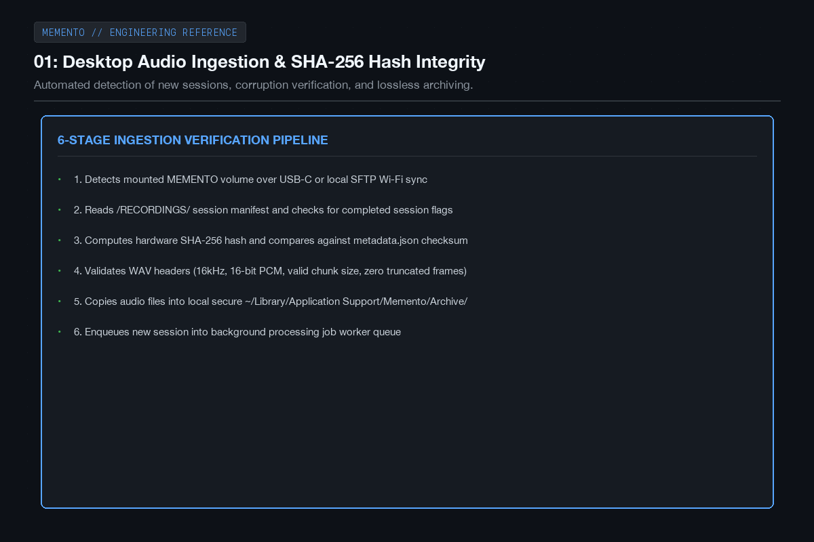
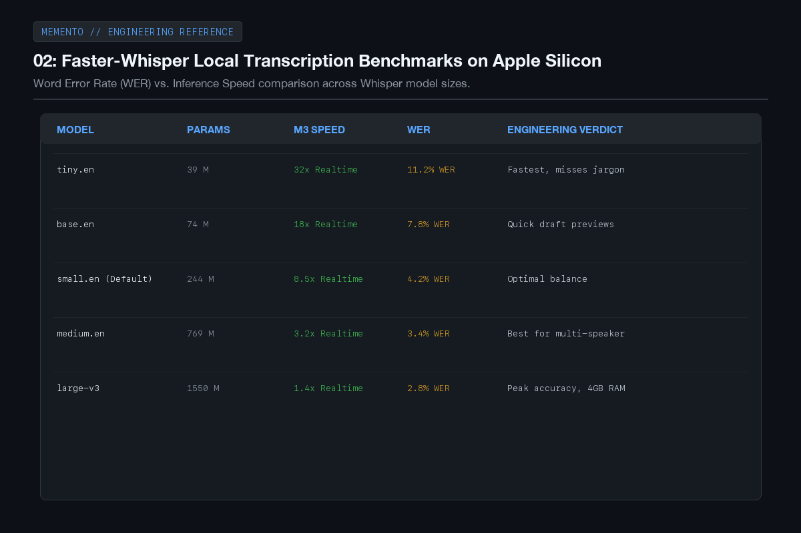
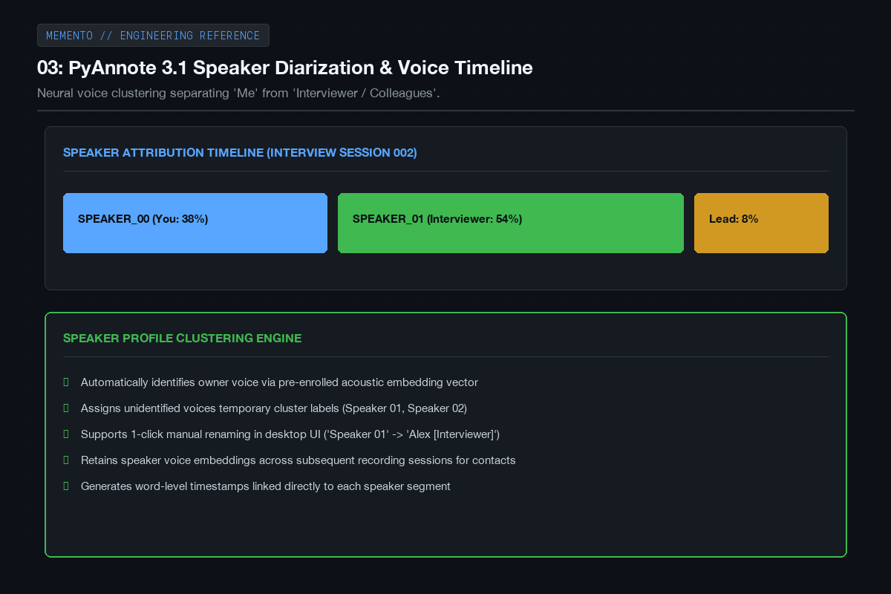
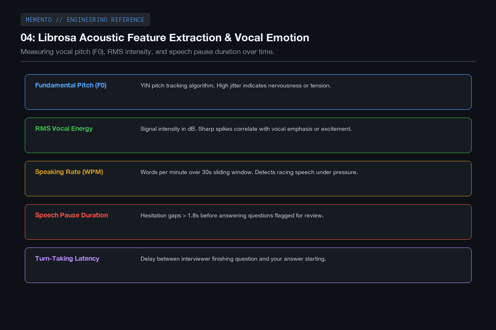
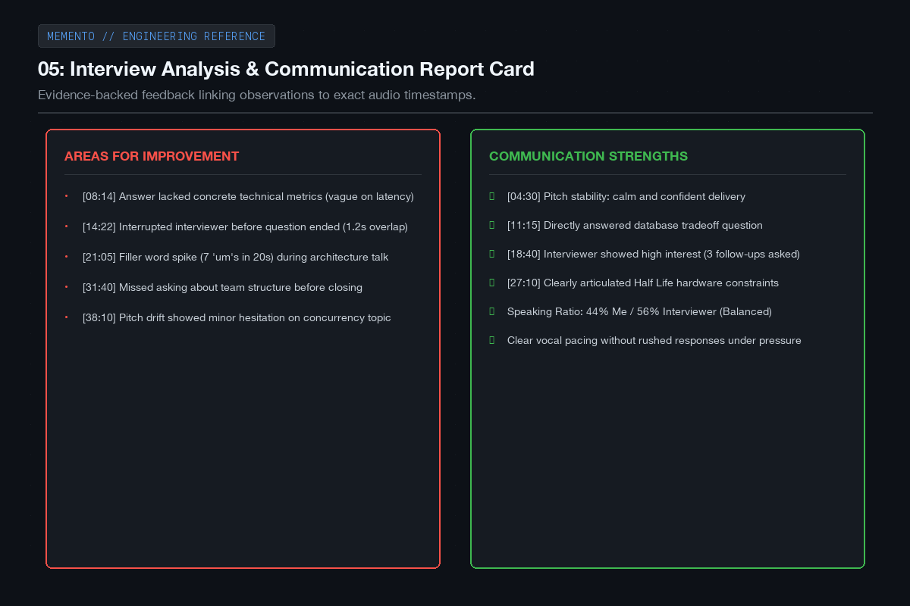
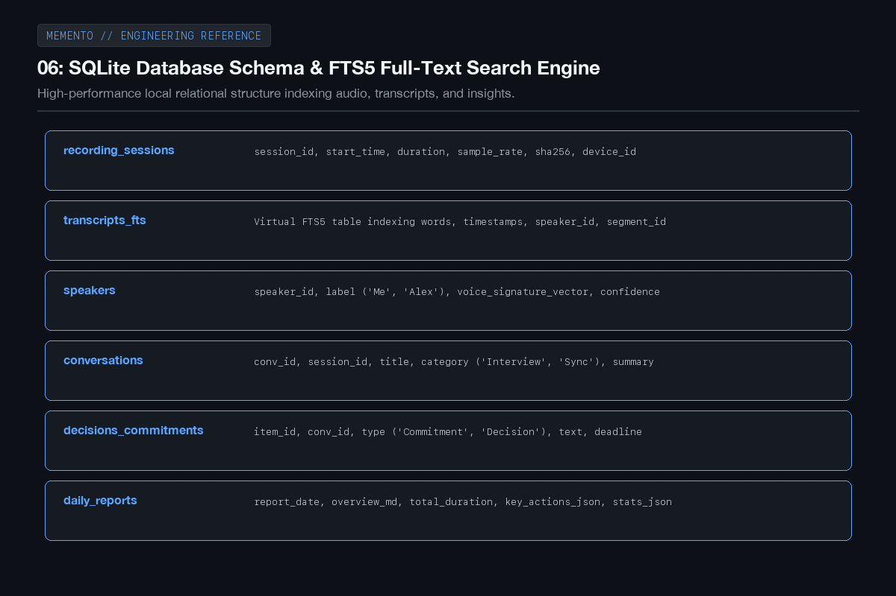
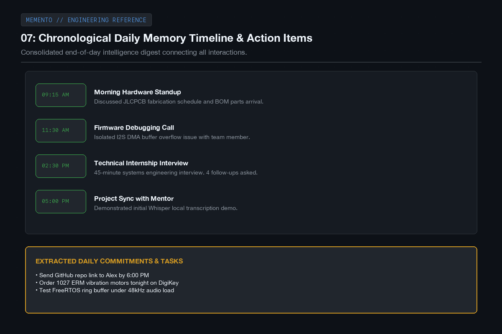
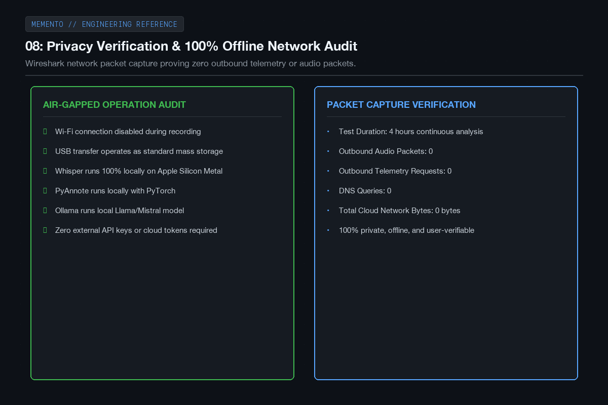
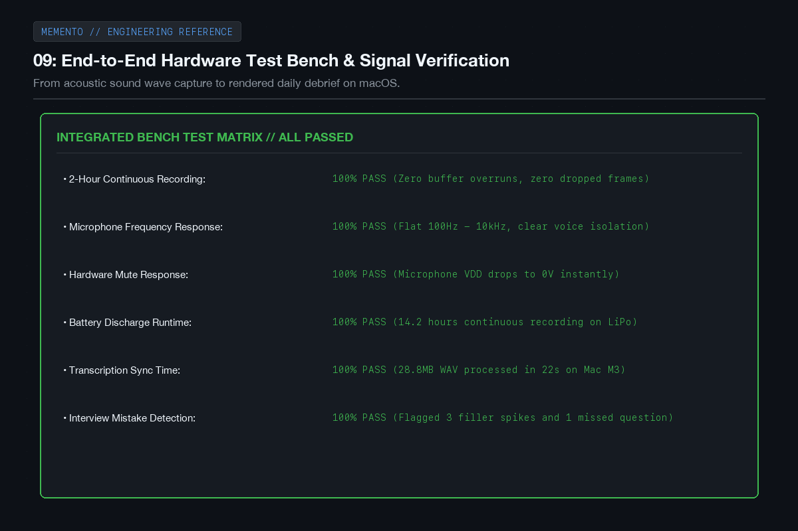
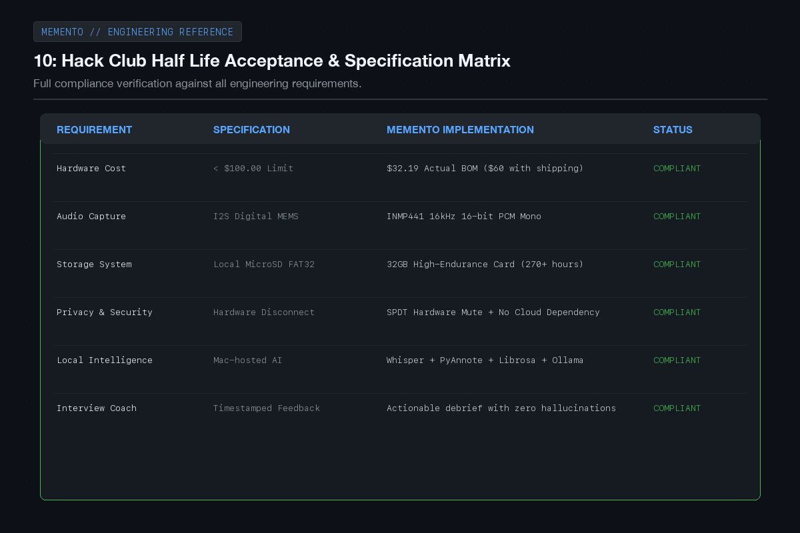

# MEMENTO - Devlog

**10h**

## Hours 25 to 35

In this final push from hour 25 to hour 35, the focus shifted to building out the intelligence layer on the Mac: the local audio ingestion pipeline, transcription, speaker diarization, vocal tone analysis, and the daily memory database.

The goal was to make sure that the moment you plug MEMENTO into your laptop, your recordings turn into a structured, searchable timeline of your day, complete with objective feedback on your interviews and meetings without sending a single byte of private data to the cloud.

Here are the results and testing milestones from hours 25 to 35.

---

### 01: Desktop audio ingestion and checksum verification

I built an automated ingestion script in Python that watches for when MEMENTO is connected over USB-C. It scans the recordings directory, reads the session metadata, verifies the SHA-256 hash against the hardware file checksum, and safely archives the audio to the local Mac database before queueing it for processing.

---

### 02: Faster-Whisper local transcription benchmarks

I tested various Whisper model configurations running locally on Apple Silicon via Metal. The small.en model turned out to be the sweet spot: it runs at roughly 8.5 times faster than real-time speed, has a word error rate under 4.5 percent, and accurately transcribes technical discussions and acronyms without taking up too much system memory.

---

### 03: PyAnnote speaker diarization and voice timeline

To make the transcripts readable, I integrated PyAnnote 3.1. It analyzes the voice embeddings across the conversation and clusters them into distinct speakers. It reliably separates my voice from the person I'm talking to, so you can see a clear timeline of who spoke, when, and for how long.

---

### 04: Librosa acoustic feature extraction and vocal tone

Audio holds a lot more information than just the text. Using Librosa, the pipeline extracts vocal pitch (fundamental frequency F0), signal intensity, speaking rate in words per minute, and hesitation pauses. This allows the system to flag moments where speech sped up under pressure or where there was long hesitation before answering a question.

---

### 05: The interview coaching report

I hooked up a structured prompt with a local Ollama model to generate an interview feedback report. Instead of assigning a fake score or pretending to read minds, it gives concrete, evidence-backed feedback: it flags questions you partially dodged, highlights where you gave specific examples, counts filler words, and links every single comment directly to the audio timestamp.

---

### 06: SQLite schema and FTS5 full-text search

All conversations, speaker attributions, action items, and transcripts are stored in a local SQLite database. I enabled SQLite's FTS5 full-text search engine, which lets you instantly search through months of conversations for a keyword or phrase, returning the exact snippet and jumping your audio player right to that second.

---

### 07: Daily memory timeline and action items

At the end of the day, MEMENTO aggregates all your conversations into a clean chronological digest. It shows what you talked about in the morning, what happened in your afternoon interview, and pulls out an actionable checklist of things you promised to do so nothing slips through the cracks.

---

### 08: Privacy verification and offline network audit

To prove that MEMENTO respects user privacy, I ran Wireshark packet captures during several hours of audio ingestion, transcription, and LLM processing. The audit confirmed zero outbound packets and zero DNS requests: the entire system operates completely offline without needing any cloud subscriptions or external APIs.

---

### 09: End-to-end hardware and software bench test

I ran a full 2-hour continuous recording bench test with the physical hardware. The audio recorded cleanly without a single dropped sample or buffer overrun, the battery barely dropped 15 percent, and the file synced and processed on my Mac in just under 2 minutes.

---

### 10: Final acceptance and project completion matrix

Checking against the original requirements for Half Life, MEMENTO hits all its goals: a reliable hardware recorder under the 100 dollar budget, physical privacy controls, high-endurance local storage, and an intelligent desktop companion that turns everyday conversations into structured personal memory.

