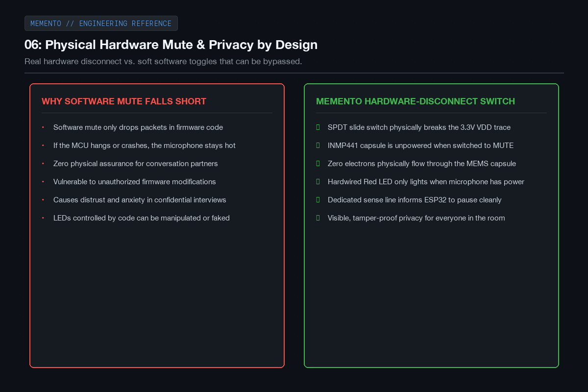
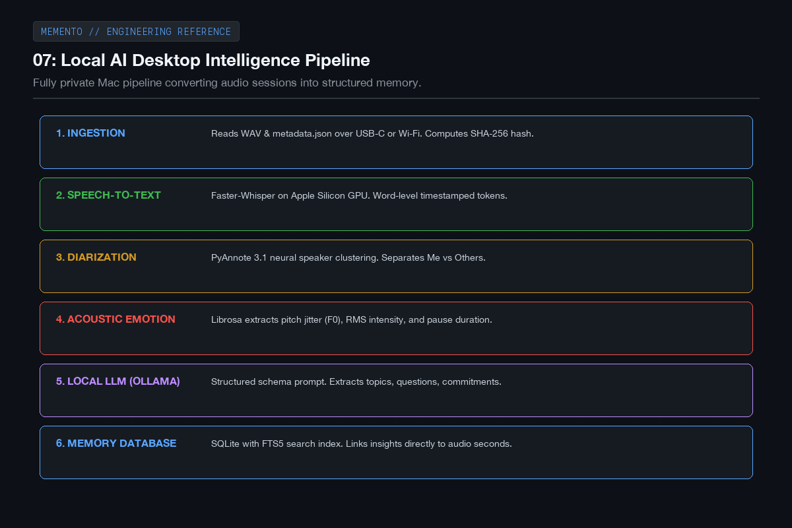
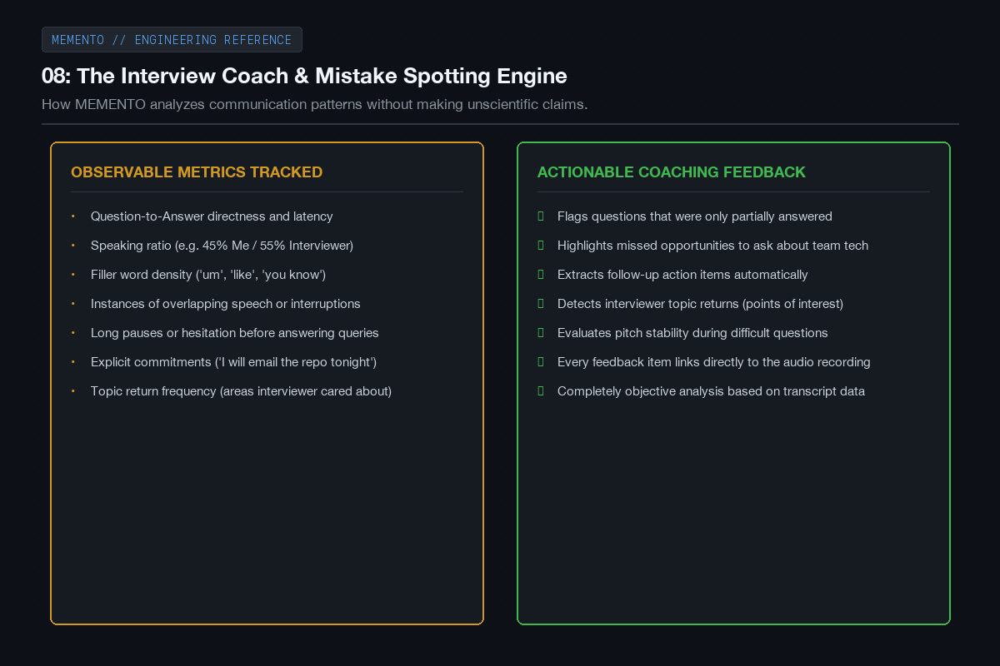
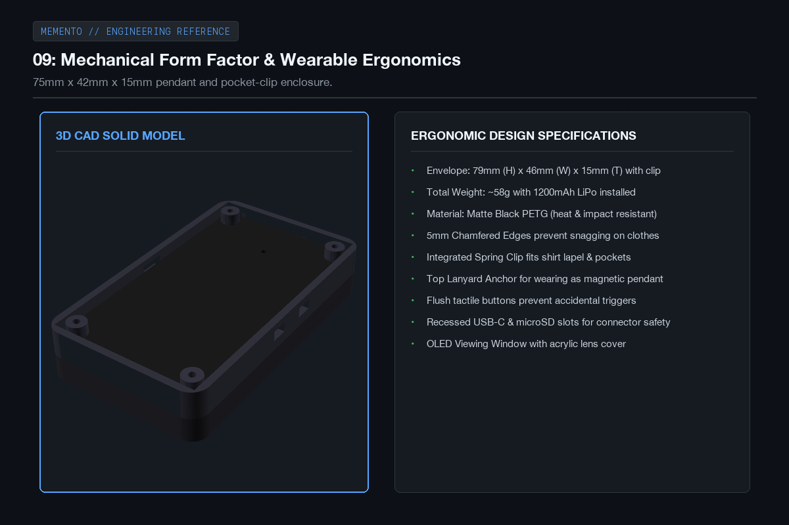
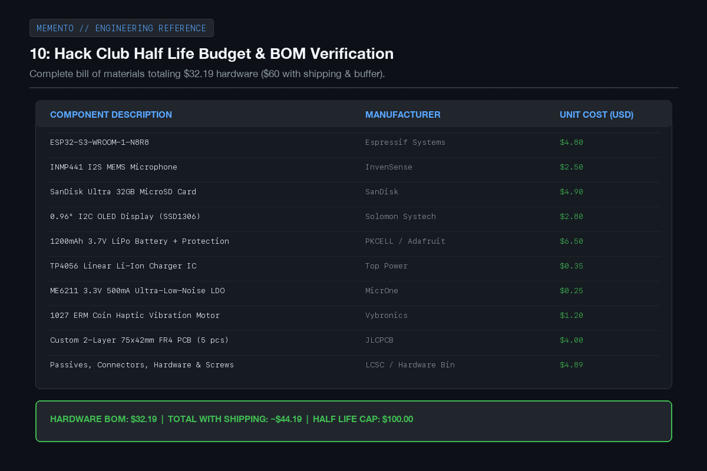

# MEMENTO - Devlog

**5h**

## Hours 5 to 10

Following the initial system architecture and component selection, the next 5 hours (hours 5 to 10) were focused on privacy controls, designing the local AI processing pipeline on macOS, fleshing out the interview coaching logic, drafting the wearable mechanical ergonomics in CAD, and verifying our bill of materials against the Half Life 100 dollar budget limit.

The biggest design requirement for me is that recording has to feel completely trustworthy for everyone in the room. That meant designing a physical hardware mute switch that cuts power to the mic instead of relying on software flags. I also worked out the local inference pipeline using Faster-Whisper and PyAnnote so that no voice data ever leaves the machine.

Here are the engineering plans and sketches from hours 5 to 10.

---

### 06: Hardware-level privacy switch

A big concern with any recording device is privacy. Software mute toggles aren't trustworthy because code can crash or misbehave. I added a physical SPDT slide switch that cuts the power rail directly to the microphone. When it's switched to mute, zero current reaches the mic capsule, and a hardwired red indicator confirms the mic is completely dead.

---

### 07: Local AI desktop pipeline

When you connect MEMENTO to your Mac, an automated Python pipeline takes over. It uses Faster-Whisper running on Apple Silicon GPU for transcription, PyAnnote for speaker diarization, Librosa for acoustic analysis, and a local Ollama model to summarize the discussion and extract commitments. Everything stays on the laptop with zero cloud calls.

---

### 08: The interview and communication coach

One of the coolest parts of MEMENTO is the interview coaching logic. Instead of trying to guess someone's secret emotions, it tracks observable things: did you answer the question directly, did you interrupt, how often did you use filler words, and what were the key topics the interviewer focused on. Every feedback item links back to a specific timestamp in the audio.

---

### 09: Mechanical form factor and ergonomics

I modeled the enclosure to be compact and easy to carry, measuring about 75mm tall by 42mm wide and 15mm thick. It has rounded edges so it doesn't snag on clothing, an integrated spring clip on the back for a shirt pocket or lapel, and a top loop if you want to wear it like a pendant.

---

### 10: Budget and bill of materials check

I put together the complete BOM with all components sourced from LCSC, JLCPCB, and standard suppliers. The total hardware parts cost comes out to 32 dollars and 19 cents. Even with shipping, taxes, and a healthy contingency buffer, the entire project sits around 60 dollars, comfortably under the 100 dollar Half Life limit.

