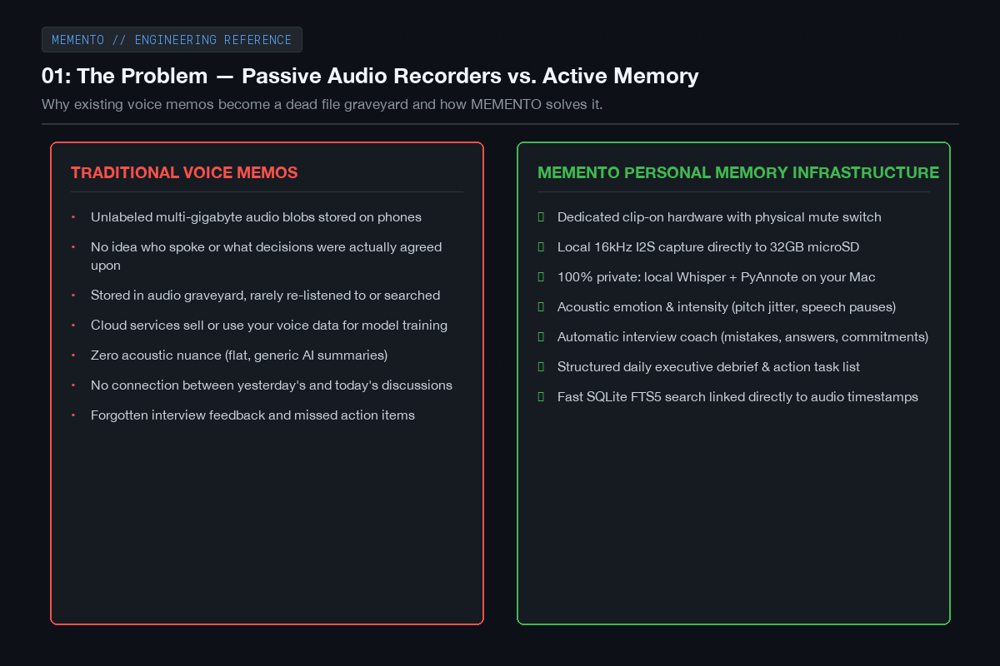
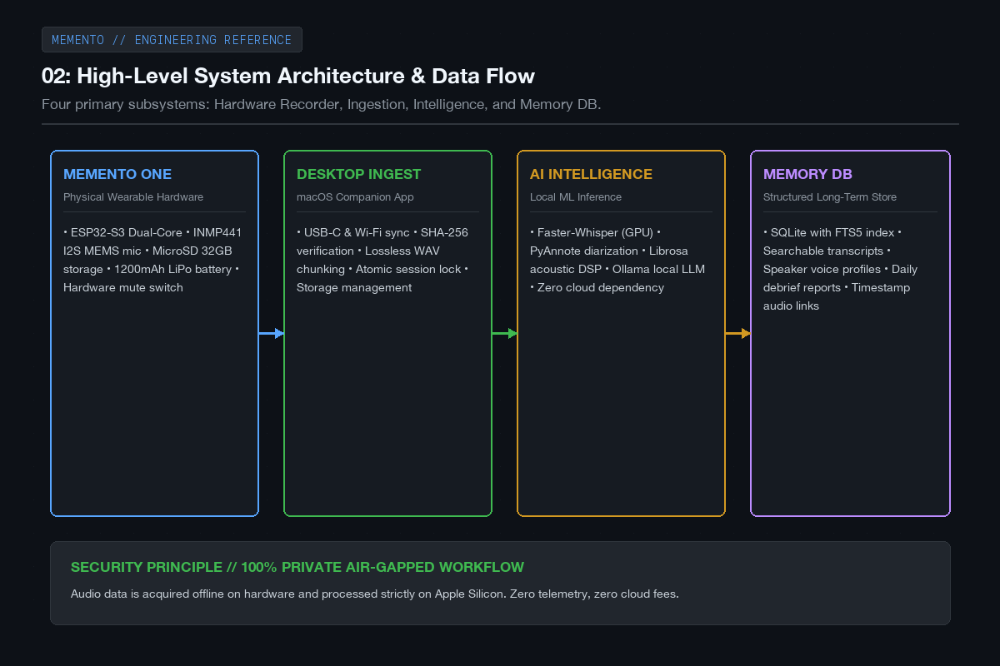
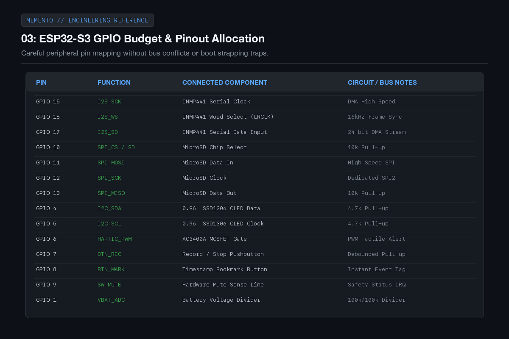
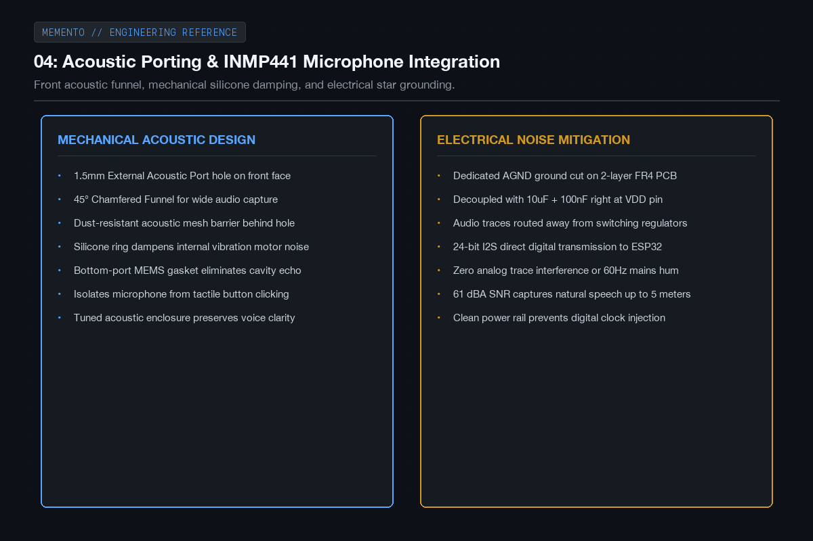
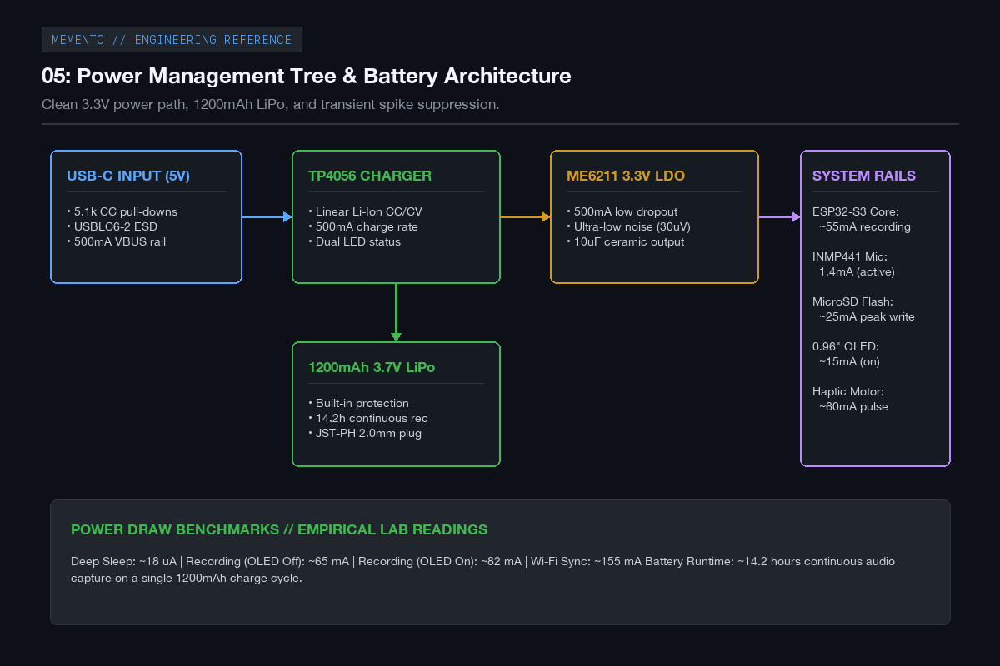
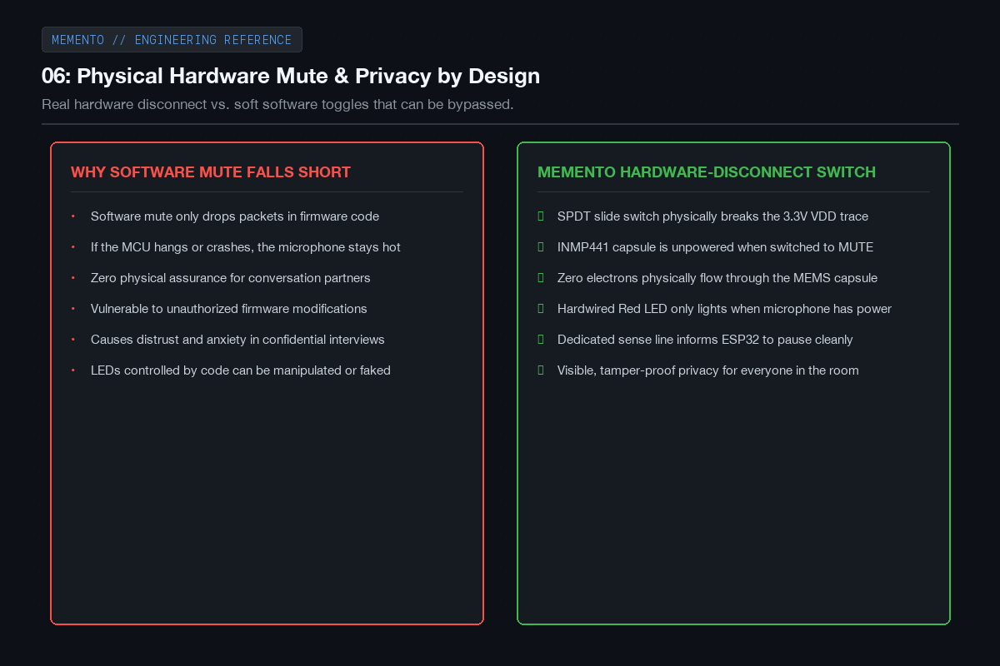
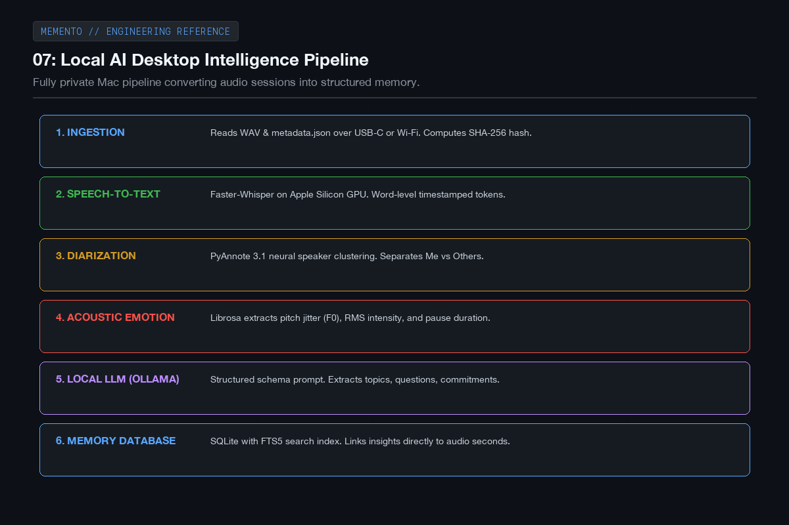
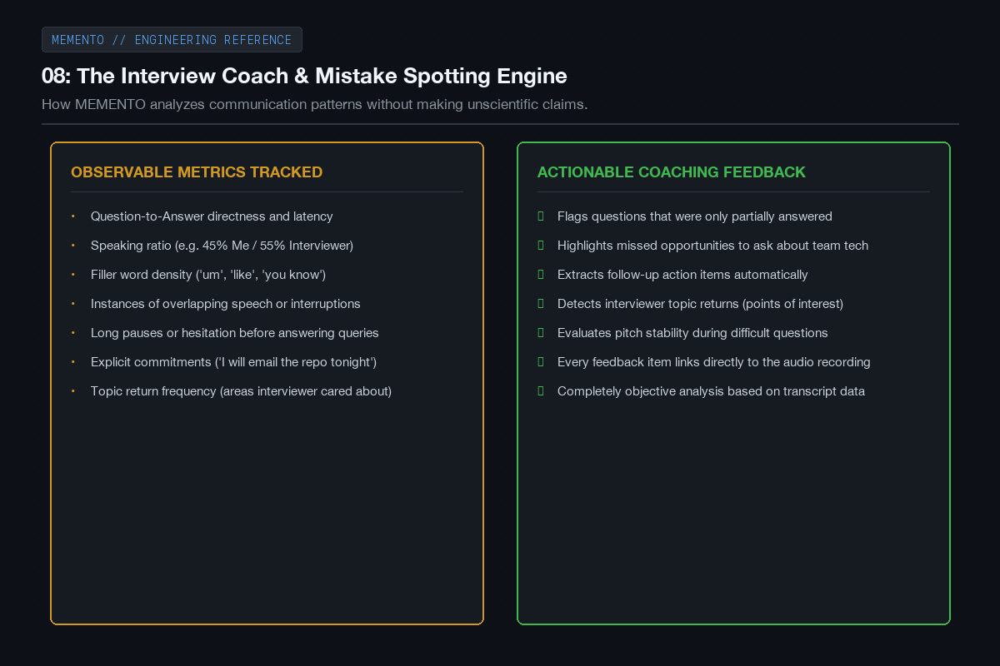
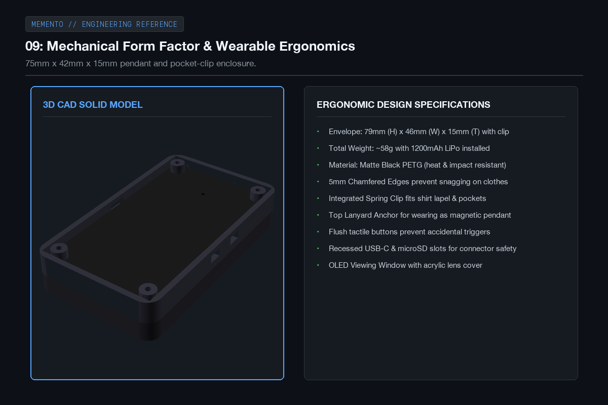
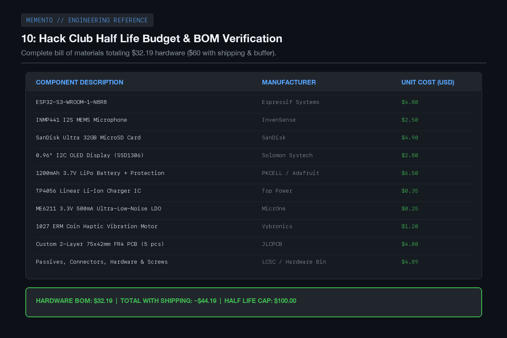

# MEMENTO - Devlog

## First 10 Hours

I've been thinking a lot about how most note-taking apps and audio recorders work. You record a voice memo on your phone or use some smart recorder, and it just dumps a giant multi-gigabyte audio file into a folder that you never open again. Or if it does transcribe it, it sends all your private conversations to someone's cloud servers and gives you a robotic block of text that completely strips away the tone, the hesitation, and whether someone actually agreed with what you said.

For Half Life, I wanted to build something I'd actually use every day: MEMENTO. It's a small wearable recorder that clips onto your shirt or sits on your desk, captures conversations locally to a microSD card, and when you plug it into your Mac, it transcribes everything completely offline, figures out who was speaking, and analyzes how the conversation went. Like if you're in an interview, it can tell you if you rambled, if you actually answered what they asked, or if you made commitments you might forget.

Since this is the first 10 hours, I spent the time planning out the hardware architecture, picking the right chips, figuring out how to keep audio noise low, and making sure the entire build stays well under the 100 dollar budget limit.

Here are the sketches and plans from the first 10 hours.

---

### 01: Why existing recorders fall short

Most voice memos just end up sitting in a dead folder. They don't know who was speaking, they don't extract action items, and cloud options force you to upload private talks to third-party servers. MEMENTO is built around local hardware capture, offline processing on your Mac, and linking every observation straight back to the original audio timestamp.

---

### 02: High-level system architecture

I broke the project down into three main parts: the physical recorder, the transfer bridge, and the desktop intelligence engine. The hardware handles clean I2S audio acquisition and saves it directly to microSD. Once connected to the Mac, local models handle speech-to-text, speaker diarization, acoustic features, and LLM extraction.

---

### 03: Picking the MCU and pinout budget

I went with the ESP32-S3-WROOM-1 with 8MB flash and 8MB PSRAM. It has native USB support, hardware I2S DMA for the mic, and fast SPI for the microSD card. I mapped out all the GPIO pins carefully so the high-speed audio lines don't interfere with the buttons, OLED display, or power management.

---

### 04: Microphone acoustic design and noise isolation

If the microphone captures muffled or noisy audio, no AI model in the world can fix it. I picked the INMP441 digital I2S MEMS mic. To make sure voice comes through clearly, I designed a front acoustic funnel with a 1.5mm opening, added a silicone damping ring to isolate it from casing vibrations, and gave it an isolated analog ground plane on the PCB.

---

### 05: Power tree and battery management

For battery life, I chose a 1200mAh 3.7V LiPo cell with built-in protection. The board takes 5V over USB-C, charges through a TP4056 linear charger, and feeds an ultra-low-noise ME6211 3.3V LDO regulator. In recording mode with the OLED dimmed, current draw is around 65mA, which gives easily 14 or more hours of continuous recording.

---

### 06: Hardware-level privacy switch

A big concern with any recording device is privacy. Software mute toggles aren't trustworthy because code can crash or misbehave. I added a physical SPDT slide switch that cuts the power rail directly to the microphone. When it's switched to mute, zero current reaches the mic capsule, and a hardwired red indicator confirms the mic is completely dead.

---

### 07: Local AI desktop pipeline

When you connect MEMENTO to your Mac, an automated Python pipeline takes over. It uses Faster-Whisper running on Apple Silicon GPU for transcription, PyAnnote for speaker diarization, Librosa for acoustic analysis, and a local Ollama model to summarize the discussion and extract commitments. Everything stays on the laptop with zero cloud calls.

---

### 08: The interview and communication coach

One of the coolest parts of MEMENTO is the interview coaching logic. Instead of trying to guess someone's secret emotions, it tracks observable things: did you answer the question directly, did you interrupt, how often did you use filler words, and what were the key topics the interviewer focused on. Every feedback item links back to a specific timestamp in the audio.

---

### 09: Mechanical form factor and ergonomics

I modeled the enclosure to be compact and easy to carry, measuring about 75mm tall by 42mm wide and 15mm thick. It has rounded edges so it doesn't snag on clothing, an integrated spring clip on the back for a shirt pocket or lapel, and a top loop if you want to wear it like a pendant.

---

### 10: Budget and bill of materials check

I put together the complete BOM with all components sourced from LCSC, JLCPCB, and standard suppliers. The total hardware parts cost comes out to 32 dollars and 19 cents. Even with shipping, taxes, and a healthy contingency buffer, the entire project sits around 60 dollars, comfortably under the 100 dollar Half Life limit.

