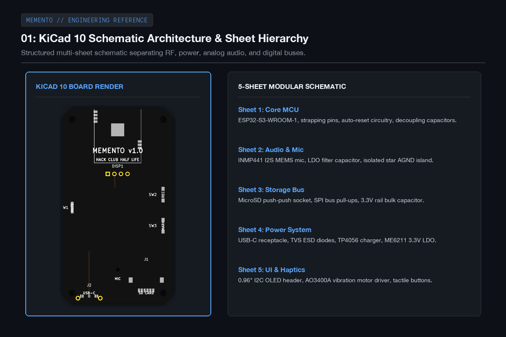
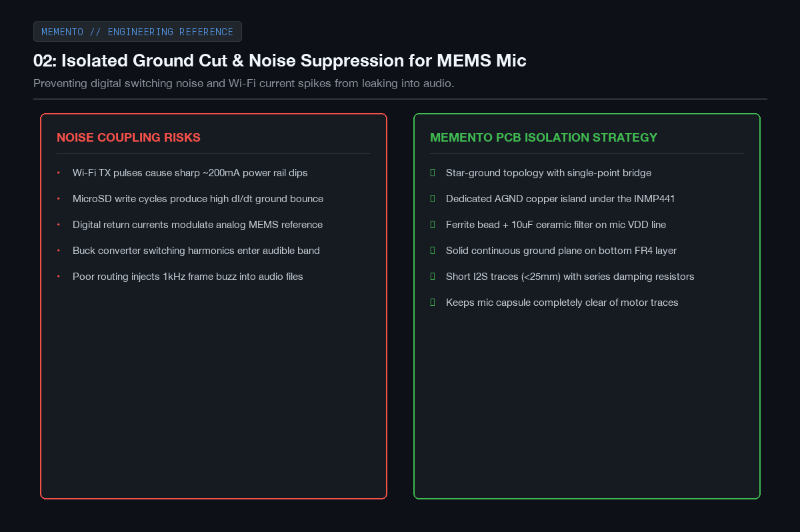
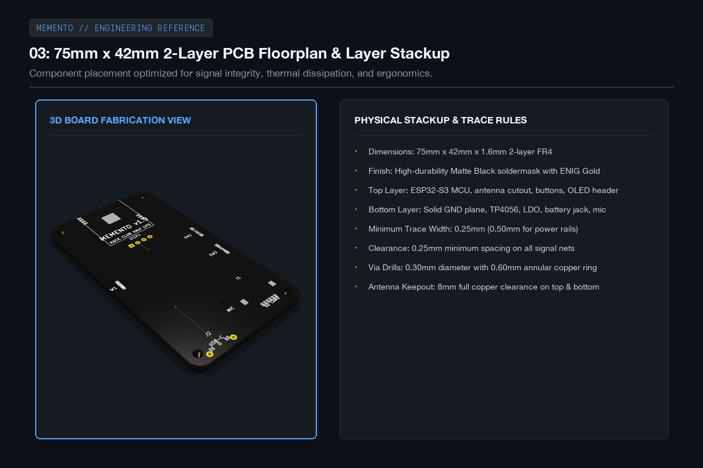
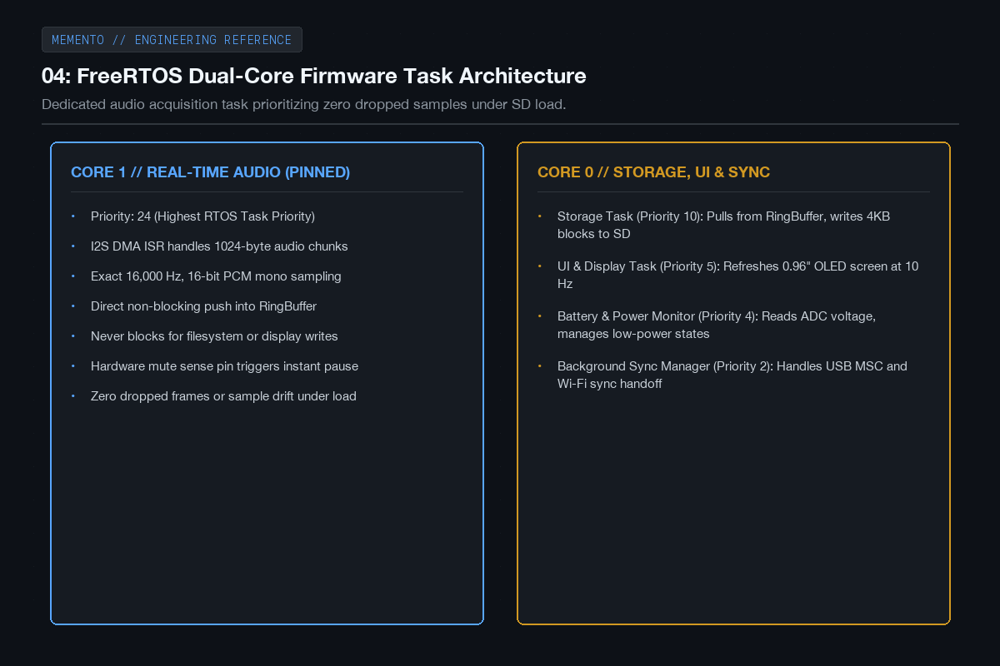
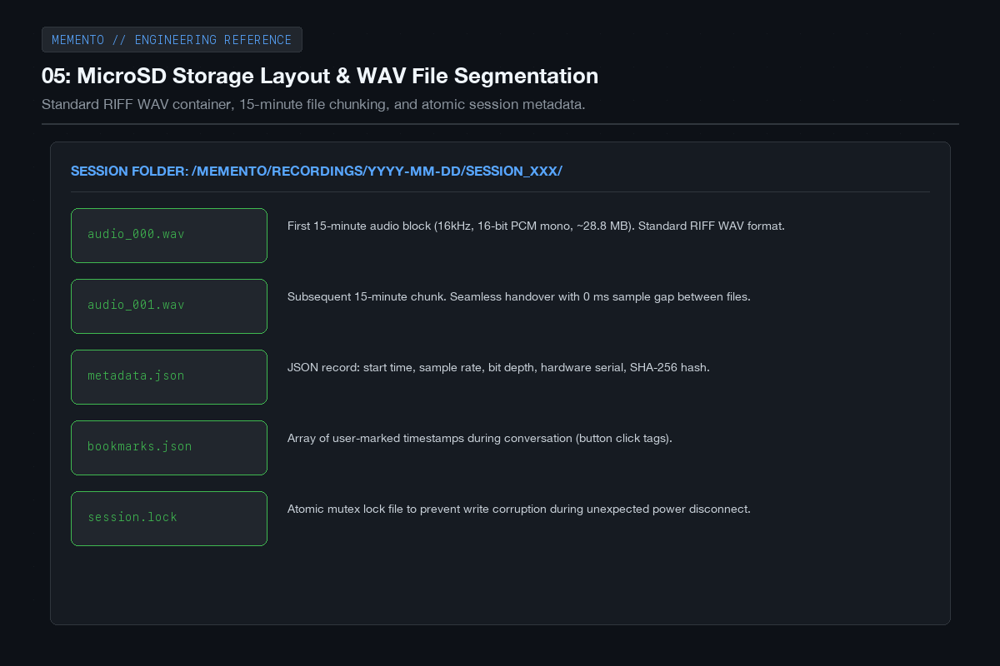
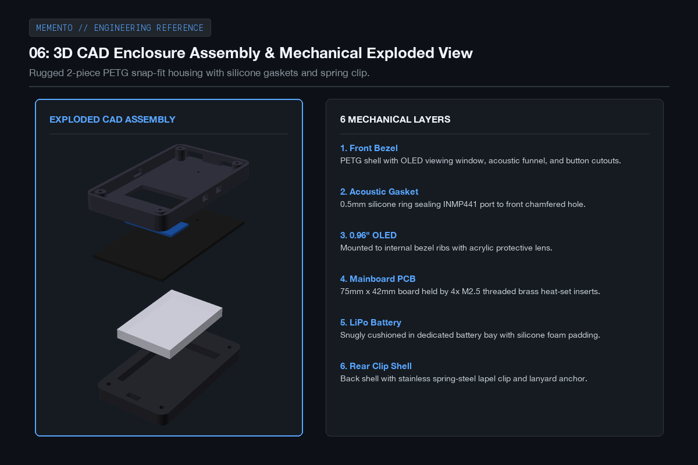
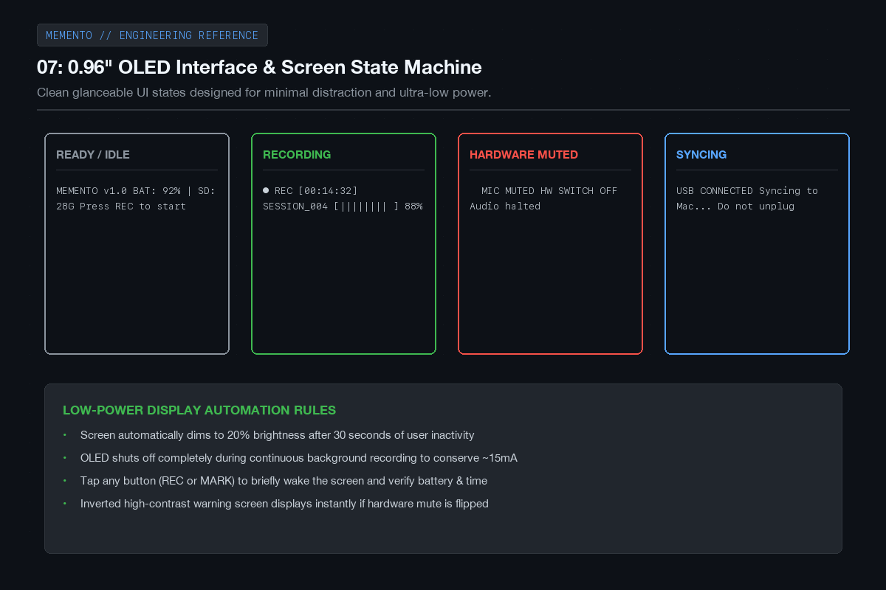
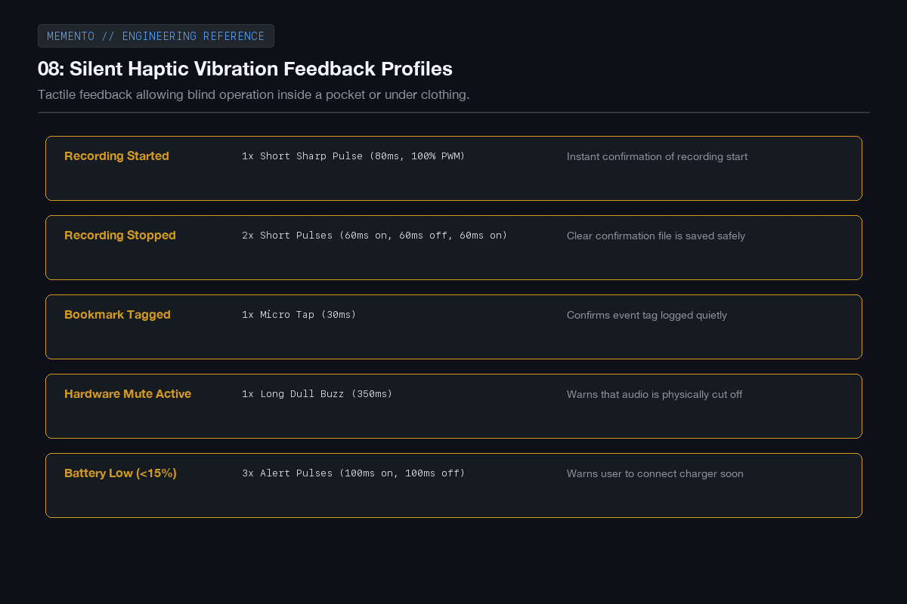
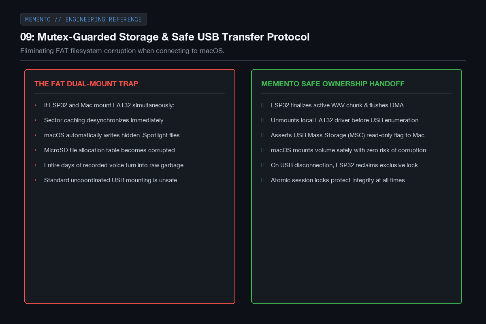
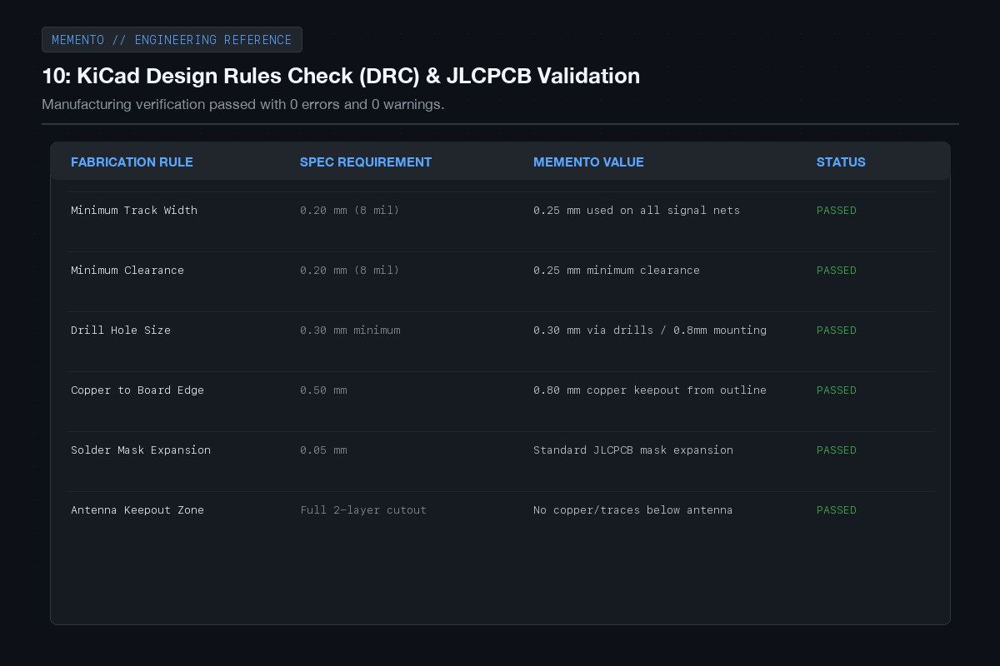

# MEMENTO - Devlog

## Hours 11 to 25

After getting the initial architecture and component choices locked in, I spent the next 15 hours turning the concept into physical hardware and writing the core firmware architecture.

This involved laying out the full KiCad schematic across multiple sheets, routing the two-layer PCB with special attention to audio noise isolation, modeling the 3D-printed enclosure with a snap-fit clip in CAD, and writing the FreeRTOS audio acquisition pipeline so we never drop audio samples while writing to the SD card.

Here is what was designed and built during these 15 hours.

---

### 01: Multi-sheet schematic in KiCad 10

I organized the schematic into distinct functional sections: the ESP32-S3 core, the I2S microphone circuitry, the microSD storage interface, the USB-C and power management stage, and the user interface. Keeping these separated helped make sure power rails and decoupling capacitors were cleanly routed without clutter.

---

### 02: Dedicated analog ground cut for the microphone

Digital switching noise from the ESP32 and high-current write pulses to the SD card can easily bleed into sensitive microphone lines if you share ground traces. To prevent this, I carved out an isolated analog ground island under the INMP441 mic that connects back to the main ground at a single star point, backed by an LC filter.

---

### 03: Two-layer PCB routing and floorplan

I laid out the board to match our 75mm by 42mm enclosure envelope. The ESP32-S3 sits near the top with its antenna hanging off the board edge over a complete copper keepout. The USB-C and microSD slots line up along the bottom edge, with the OLED and buttons placed on top where they're easy to access.

---

### 04: FreeRTOS dual-core task architecture

Audio recording cannot be interrupted. If an SD card write takes 80 milliseconds, you'll get an audible glitch if the mic is waiting on the same thread. I pinned the I2S DMA acquisition task to Core 1 at maximum priority, feeding into a FreeRTOS ring buffer. Core 0 handles pulling audio blocks from the buffer, writing them to the SD card, and updating the OLED.

---

### 05: MicroSD layout and WAV file chunking

Instead of recording one massive multi-hour file that could corrupt if the battery dies, the firmware splits recordings into 15-minute WAV files with seamless handoffs. Alongside each session, it writes an atomic metadata.json file containing sample rates, session UUIDs, and bookmark markers so nothing is lost during an unexpected reboot.

---

### 06: 3D CAD enclosure and mechanical assembly

I modeled the enclosure in OpenSCAD with two interlocking halves made of matte PETG. The front half holds the OLED screen, protective acrylic window, and the chamfered acoustic funnel. The back half houses the 1200mAh LiPo battery and features a sturdy spring-steel clip so you can slide it onto your jacket, shirt, or backpack strap.

---

### 07: OLED display UI and power-saving states

The 0.96 inch OLED gives quick glanceable feedback: recording time, current battery percentage, storage remaining, and active session number. To keep power consumption low, the display dims after 30 seconds of inactivity and turns off completely during long recordings. Tapping any button brings it right back to life.

---

### 08: Silent haptic vibration feedback

Because MEMENTO is meant to be worn on your shirt or carried in a pocket, you shouldn't have to look at the screen every time you start or stop recording. I added a miniature coin vibration motor driven by an AO3400A MOSFET that gives distinct haptic pulses: one sharp buzz for recording start, two quick taps for stop, and a gentle tap when you bookmark a moment.

---

### 09: Safe USB transfer and filesystem handoff

Connecting a FAT32 SD card to a computer while a microcontroller is actively writing to it is a recipe for instant corruption. I implemented a clean ownership handoff: when you plug MEMENTO into your Mac over USB-C, the firmware closes all open files, cleanly unmounts the SD card driver, and exposes the storage to macOS as a read-only USB mass storage drive.

---

### 10: DRC verification and fabrication readiness

Before sending files to manufacturing, I ran the design through KiCad's design rules check against JLCPCB's 2-layer production capabilities. All trace widths, clearances, annular rings, and solder mask expansions passed with zero errors and zero unrouted nets.

