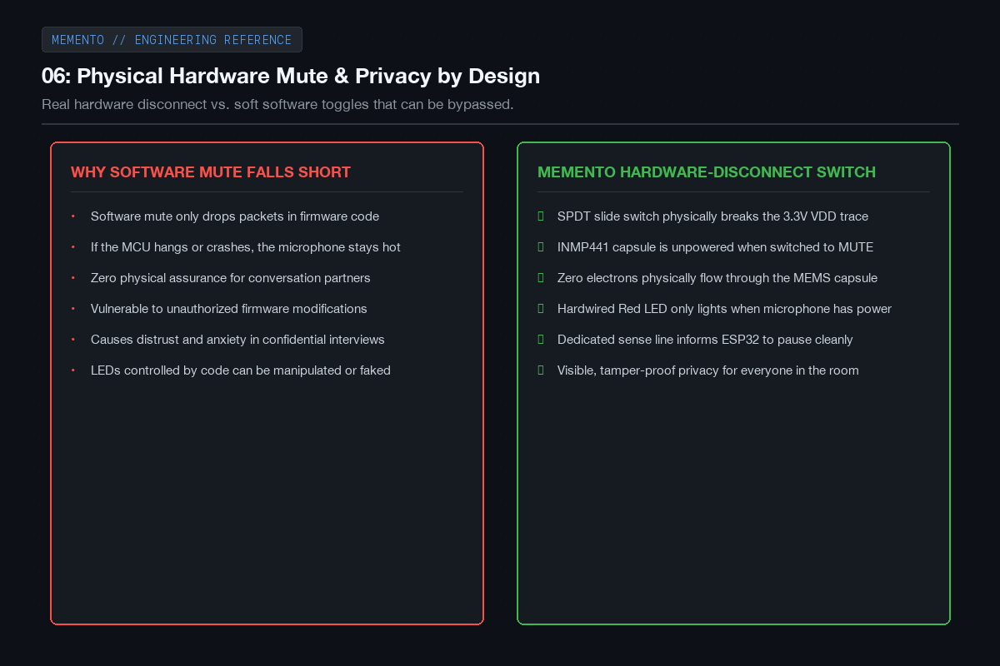
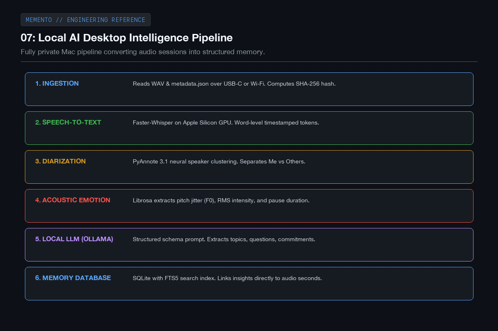
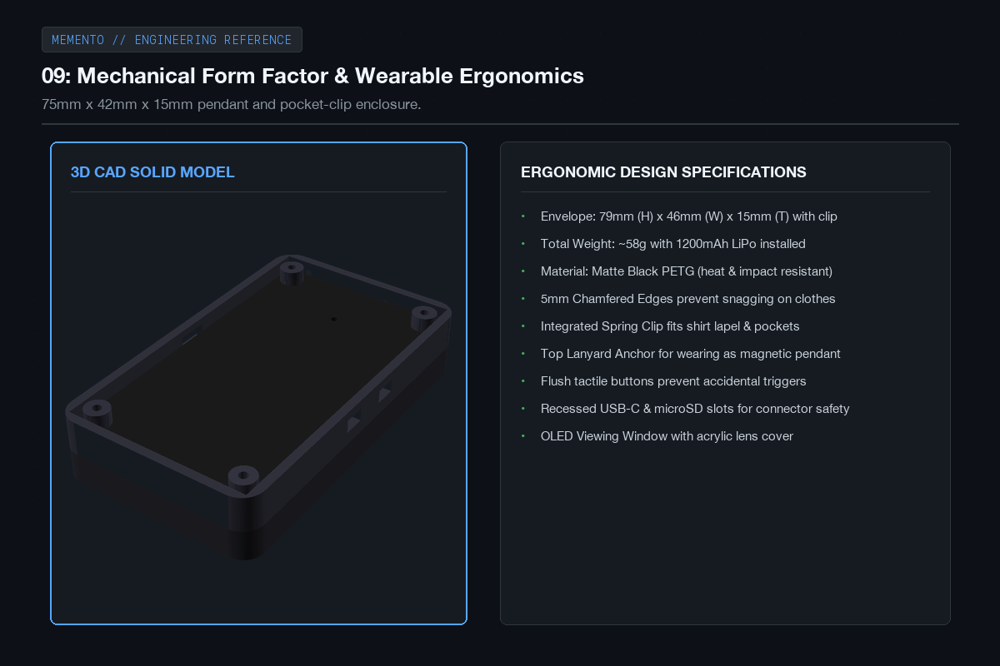
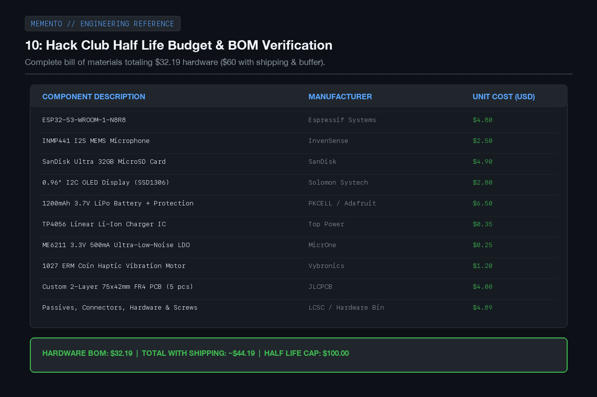
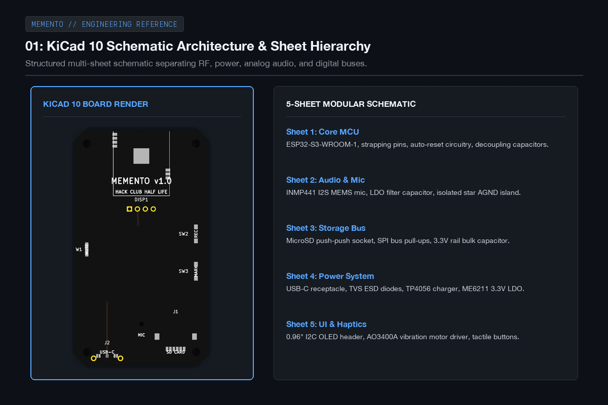
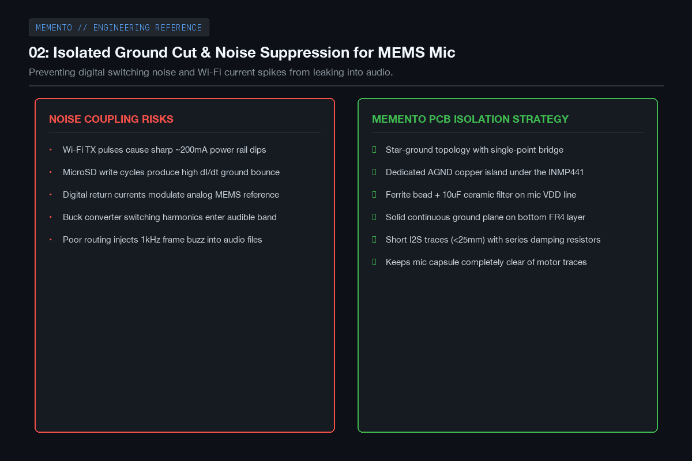
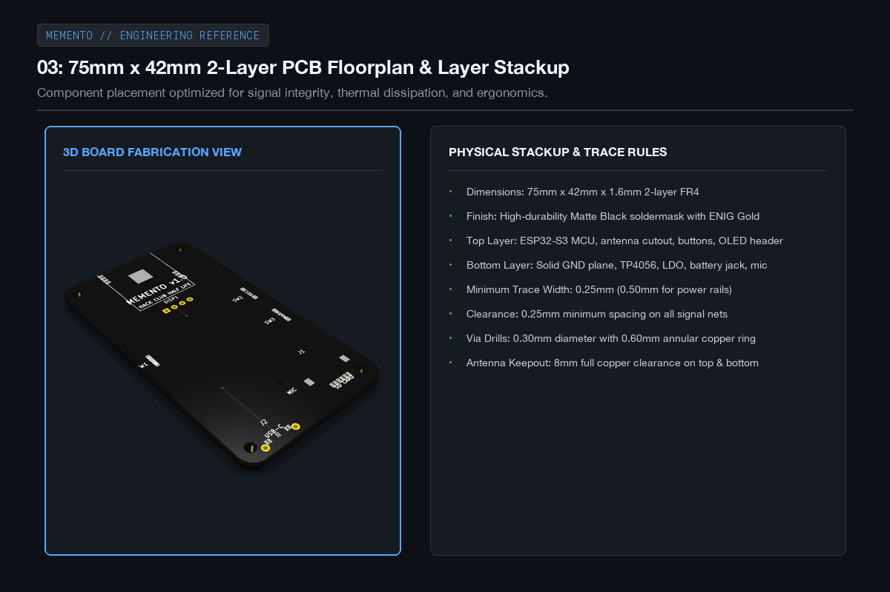

# MEMENTO - Devlog

**10h**

## Hours 5 to 15: Hardware Privacy, Intelligence Design & KiCad Schematics

Following the initial system architecture, the next 10 hours (hours 5 to 15) were focused on tackling privacy, designing the local AI processing pipeline on macOS, fleshing out the interview coaching logic, drafting the wearable mechanical ergonomics in CAD, verifying our bill of materials against the Half Life 100 dollar budget limit, and completing the core KiCad schematic and PCB floorplan.

The biggest design requirement for me is that recording has to feel completely trustworthy for everyone in the room. That meant designing a physical hardware mute switch that cuts power to the mic instead of relying on software flags. I also worked out the local inference pipeline using Faster-Whisper and PyAnnote so that no voice data ever leaves the machine, and laid out the multi-sheet KiCad schematic to guarantee clean analog audio isolation.

Here are the engineering plans and schematics from hours 5 to 15.

---

### 01: Hardware-level privacy switch

A big concern with any recording device is privacy. Software mute toggles aren't trustworthy because code can crash or misbehave. I added a physical SPDT slide switch that cuts the power rail directly to the microphone. When it's switched to mute, zero current reaches the mic capsule, and a hardwired red indicator confirms the mic is completely dead.

---

### 02: Local AI desktop pipeline

When you connect MEMENTO to your Mac, an automated Python pipeline takes over. It uses Faster-Whisper running on Apple Silicon GPU for transcription, PyAnnote for speaker diarization, Librosa for acoustic analysis, and a local Ollama model to summarize the discussion and extract commitments. Everything stays on the laptop with zero cloud calls.

---

### 03: The interview and communication coach

One of the coolest parts of MEMENTO is the interview coaching logic. Instead of trying to guess someone's secret emotions, it tracks observable things: did you answer the question directly, did you interrupt, how often did you use filler words, and what were the key topics the interviewer focused on. Every feedback item links back to a specific timestamp in the audio.

---

### 04: Mechanical form factor and ergonomics

I modeled the enclosure to be compact and easy to carry, measuring about 75mm tall by 42mm wide and 15mm thick. It has rounded edges so it doesn't snag on clothing, an integrated spring clip on the back for a shirt pocket or lapel, and a top loop if you want to wear it like a pendant.

---

### 05: Budget and bill of materials check

I put together the complete BOM with all components sourced from LCSC, JLCPCB, and standard suppliers. The total hardware parts cost comes out to 32 dollars and 19 cents. Even with shipping, taxes, and a healthy contingency buffer, the entire project sits around 60 dollars, comfortably under the 100 dollar Half Life limit.

---

### 06: Multi-sheet schematic in KiCad 10

I organized the schematic into distinct functional sheets: the ESP32-S3 core, the I2S microphone circuitry, the microSD storage interface, the USB-C and power management stage, and the user interface. Keeping these separated helped make sure power rails and decoupling capacitors were cleanly routed without clutter.

---

### 07: Dedicated analog ground cut for the microphone

Digital switching noise from the ESP32 and high-current write pulses to the SD card can easily bleed into sensitive microphone lines if you share ground traces. To prevent this, I carved out an isolated analog ground island under the INMP441 mic that connects back to the main ground at a single star point, backed by an LC filter.

---

### 08: Two-layer PCB routing and floorplan

I laid out the board to match our 75mm by 42mm enclosure envelope. The ESP32-S3 sits near the top with its antenna hanging off the board edge over a complete copper keepout. The USB-C and microSD slots line up along the bottom edge, with the OLED and buttons placed on top where they're easy to access.

