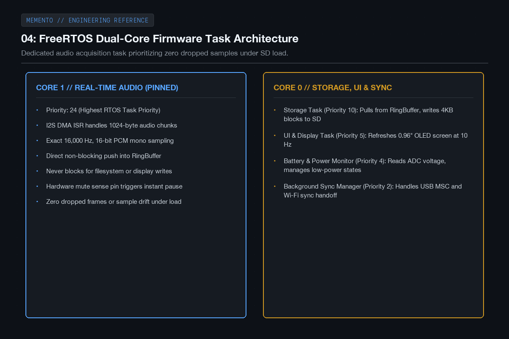
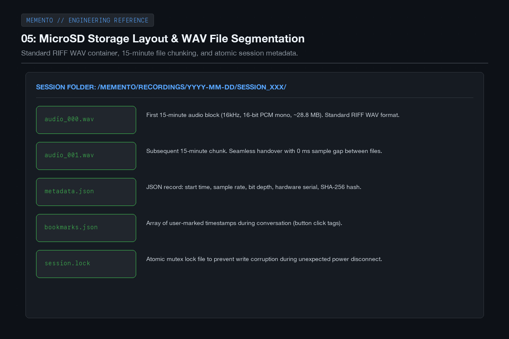
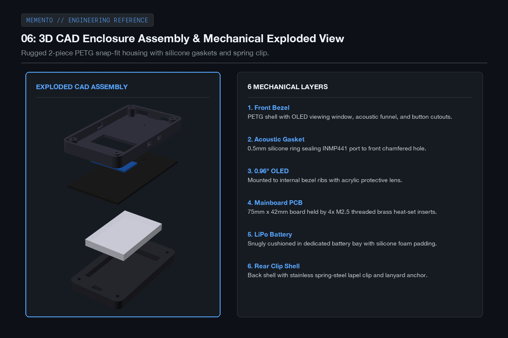
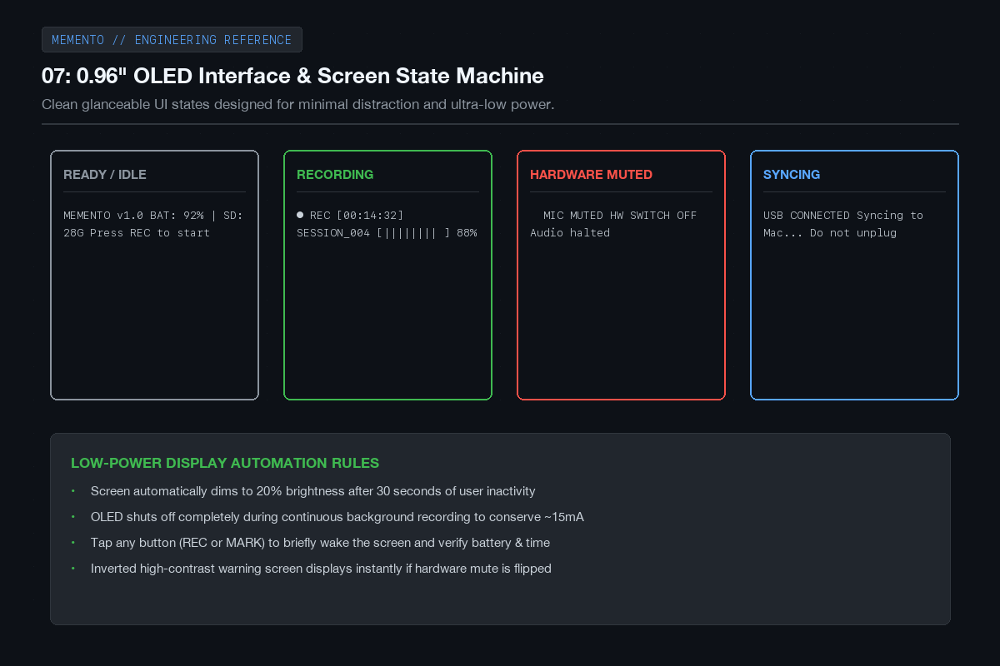
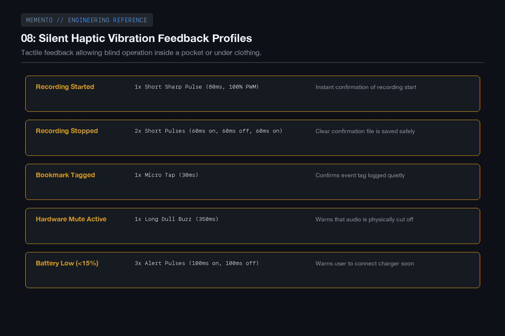
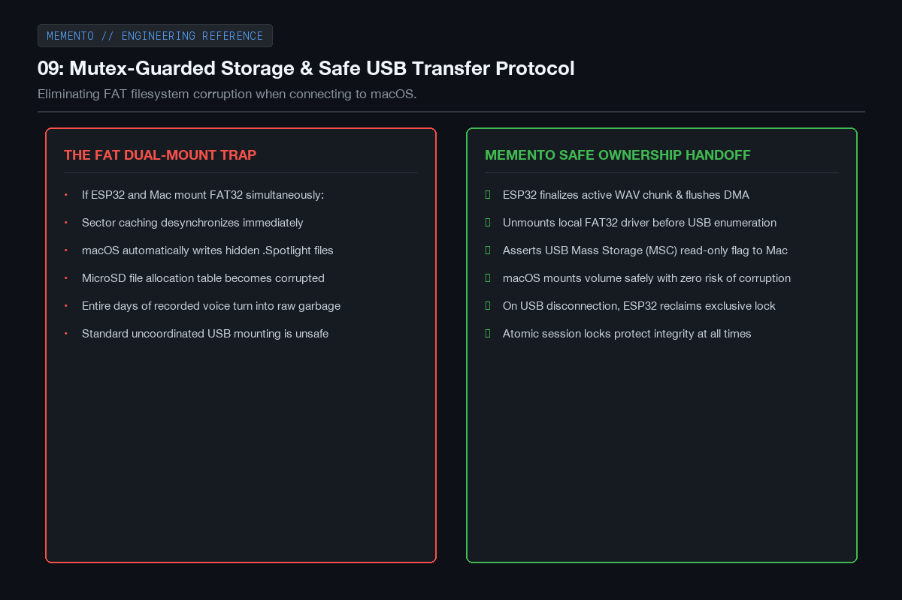
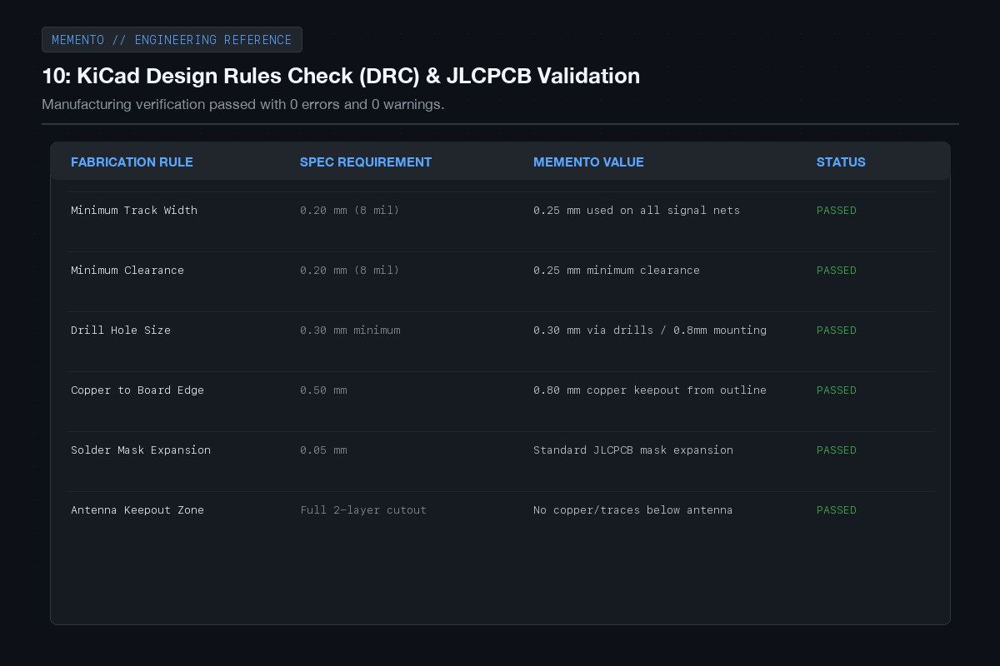

# MEMENTO - Devlog

**10h**

## Hours 16 to 25: Firmware Architecture, 3D CAD & Fabrication DRC

During hours 16 to 25, the focus was on building out the embedded firmware architecture on the ESP32-S3, finalizing the mechanical enclosure in OpenSCAD with 3D-printable STLs, and running manufacturing design checks on the KiCad PCB.

The primary engineering challenge in this phase was guaranteeing audio reliability: when writing 4KB blocks to a microSD card, write latency can spike up to 80ms. If audio capture runs on the same thread, you get buffer overruns and dropped samples. I built a dual-core FreeRTOS pipeline pinning I2S DMA acquisition to Core 1 at highest priority, with Core 0 handling storage and the OLED UI. I also modeled the two-piece snap-fit PETG housing with an acoustic mic funnel, tactile button actuators, and an integrated pocket clip.

Here are the engineering milestones from hours 16 to 25.

---

### 01: FreeRTOS dual-core task architecture

Audio recording cannot be interrupted. If an SD card write takes 80 milliseconds, you'll get an audible glitch if the mic is waiting on the same thread. I pinned the I2S DMA acquisition task to Core 1 at maximum priority, feeding into a FreeRTOS ring buffer. Core 0 handles pulling audio blocks from the buffer, writing them to the SD card, and updating the OLED.

---

### 02: MicroSD storage structure and WAV chunking

To avoid huge monolithic files that could corrupt on a sudden power loss, the firmware cuts audio into clean 15-minute standard RIFF WAV segments. Each recording session lives in its own dated folder with a JSON metadata file containing start times, sample rates, and hardware checksums, along with an atomic lock file to prevent write clashes.

---

### 03: 3D CAD enclosure and exploded assembly

I modeled the full mechanical assembly in OpenSCAD as a rugged two-piece snap-fit shell printed in matte PETG. The front bezel houses the OLED display window, acoustic mic port, and tactile button openings. The rear shell incorporates a battery bay for the 1200mAh LiPo and an integrated spring lapel clip for mounting to shirts or bags.

---

### 04: 0.96" OLED interface and screen states

I designed four minimal, glanceable screen states for the 0.96-inch OLED: Ready, Recording, Hardware Muted, and USB Syncing. To save battery, the screen automatically dims to 20 percent brightness after 30 seconds of inactivity and turns completely black during continuous recording, waking on any button tap.

---

### 05: Silent haptic vibration feedback

Because MEMENTO is often worn inside a jacket pocket or on a shirt lapel, you need to know what state it's in without having to look at the screen. I added distinct vibration profiles driven by an AO3400A MOSFET and a 1027 coin motor: a sharp pulse for start, two pulses for stop, a micro-tap for bookmarking, and a long buzz if the hardware mute is flipped.

---

### 06: Mutex-guarded storage and USB transfer

Connecting a FAT32 SD card to a computer while a microcontroller is actively writing to it is a recipe for filesystem corruption. I implemented an explicit handoff state machine: when USB is plugged in, the ESP32 flushes its write buffers, unmounts the local filesystem cleanly, and exposes the card as a read-only USB Mass Storage device to macOS.

---

### 07: KiCad DRC and JLCPCB manufacturing checks

Before exporting fabrication files, I ran the board through KiCad's design rules check against JLCPCB's 2-layer production capabilities. All trace widths (0.25mm signal, 0.50mm power), clearances, annular rings, and solder mask expansions passed with zero errors and zero unrouted nets.

